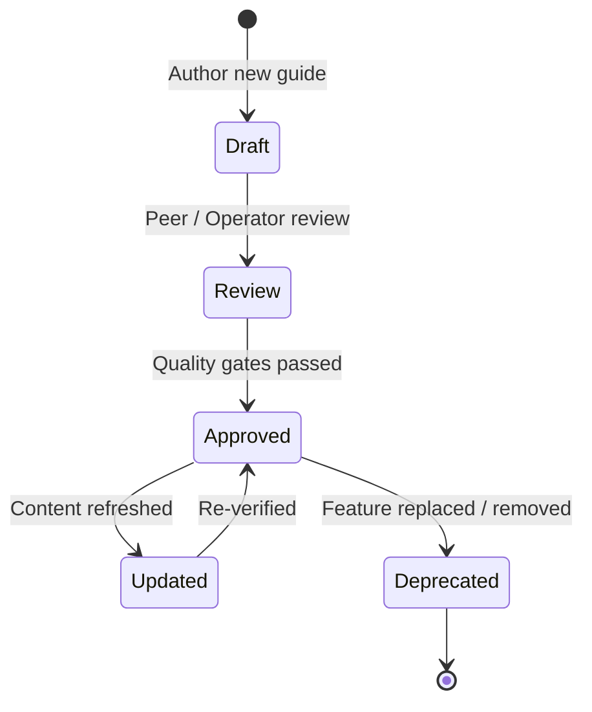

# Documentation Management & Governance Guide

> [!NOTE]
> **Status:** Available | **Last Reviewed:** 2026-10-26 | **Intended Audience:** Platform Admins, Store Admins, Operations Leads

## 1. Purpose & Overview
This guide defines how documentation across the Knowledge Management System (KMS) and in-app client surfaces is created, reviewed, updated, and governed. It provides authorised users with clear workflows for maintaining documentation accuracy, managing customer-facing FAQs without developer intervention, tracking review dates, and maintaining strict separation between client-facing guides and internal engineering records.

---

## 2. Roles, Permissions & Content Ownership

| Role | Authoring Scope | Permissions & Access | Review Responsibilities |
| :--- | :--- | :--- | :--- |
| **Store Admin** | In-app FAQs (`/staff/faqs`), store policies, operational runbook updates. | Store-scoped admin privileges via Better Auth. | Bi-weekly review of store FAQs and opening hours. |
| **Platform Admin** | Platform-wide guides, integration specs, tenant onboarding runbooks. | Global platform admin privileges. | Monthly audit of tenant guides, API endpoints, and Stripe configs. |
| **Store Staff** | Operational feedback, troubleshooting symptom reports. | Read access to `/staff/runbook` and KMS Knowledge Centre. | Flagging outdated steps or broken links during daily operations. |
| **Engineering / DevOps** | Architecture, ADRs, SDD sprint specs, codebase conventions. | Access to `/dev` and git repository. | Re-validating documentation during every SDD pull request cycle. |

---

## 3. Article Lifecycle & Status Workflow

All documentation in the knowledge base moves through a strictly enforced 4-state lifecycle:

1. **`draft`**: The article is under active drafting. Clearly marked with a banner explaining that instructions are preliminary.
2. **`review`**: Content has been written and is undergoing technical review against verified application routes and UI controls.
3. **`approved`**: The article is officially ratified, adheres to the Standard Article Template, and is indexed across search.
4. **`deprecated`**: The feature or workflow has been superseded. Deprecated articles contain prominent warnings and redirect links to modern equivalents.

---

## 4. In-App FAQ Management (No-Code Store Admin CMS)

Store Administrators can maintain public customer-facing FAQs directly from the admin panel without modifying code or triggering deployments:

### Step-by-Step Instructions:
1. Log in to the Store Admin Panel at `/staff`.
2. In the navigation sidebar, click **FAQs** (`/staff/faqs`).
3. **To Add a New FAQ:**
   - Click **Add FAQ**.
   - Enter a clear, user-focused **Question** (e.g. *"What is the minimum order value for delivery?"*).
   - Enter the detailed **Answer**, including helpful links or contact information.
   - Select the **Category** (e.g. *Delivery*, *Payments*, *Orders*, *Returns*).
   - Set **Sort Order** (integer) to control the display sequence.
   - Click **Save FAQ**.
4. **To Edit or Archive an FAQ:**
   - Locate the question in the FAQ table.
   - Click **Edit** to modify wording or change category.
   - Toggle **Active Status** to hide an FAQ without deleting it.
5. **Expected Outcome:** Changes take effect immediately on the public customer storefront FAQ page.

---

## 5. Review Cadence & Freshness Tracking

To ensure documentation never drifts from the live codebase:
- **`updated` Metadata:** Every article carries an ISO date (`YYYY-MM-DD`). Automated CI audits flag articles that have not been reviewed within 90 days.
- **SDD Gate Integration:** Whenever a feature is modified, added, or deprecated, the PR must identify affected documentation under `docs/` and update the corresponding guide before merging.
- **Verification Requirement:** Never document a feature as **Available** unless it has been verified against the live application routes and database schema. Features under active development must carry the **Planned** status.

---

## 6. Gap Tracking & Feedback Reporting

If you identify missing documentation, inaccurate steps, or broken links:
1. **Minor Fixes / Typo:** Submit a quick correction through the internal review process or update store FAQs directly.
2. **Missing Feature Guide:** File a documentation ticket referencing the relevant page route and target audience.
3. **Support Escalation:** Contact the Platform Operations Team via the verified WhatsApp channel or issue tracker.

---

## 7. Related Guides & Journey Steps
- **Vendor Admin Journey:** [Vendor Admin Store Setup & Operations](file:///E:/GitRepositories/aheed-online-store/docs/client-help-centre/user-journeys.md)
- **Store Operations Tutorials:** [Tutorials & In-App FAQs](file:///E:/GitRepositories/aheed-online-store/docs/client-help-centre/tutorials-and-faqs.md)
- **Platform Glossary:** [Glossary & Release Notes](file:///E:/GitRepositories/aheed-online-store/docs/client-help-centre/glossary-and-release-notes.md)
