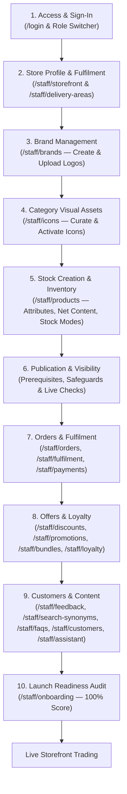

# Client Onboarding & Store Launch Readiness

This guide outlines the complete operational onboarding journey required to configure, populate, audit, and launch a store on the multi-tenant platform. It is designed to enable new staff members and store administrators to operate the platform independently.

---

## 1. Onboarding Workflow Overview

Setting up and managing a storefront follows a sequential operational workflow:

---

## 2. Sequential Staff Operational Walkthrough

### Step 1: System Access & Navigation
1. **Sign In:** Navigate to `/login`. Sign in using your store staff credentials (e.g. `staff@aheed.merqify.com`).
2. **Role Switcher:** Use the role switcher in the header chrome to toggle between:
   - **Shopper View (`/`):** The public-facing customer storefront.
   - **Staff View (`/staff`):** The operational portal for order processing and inventory.
   - **Admin View:** Accessible to store administrators for branding, banking, and team settings.
3. **Staff Overview Hub (`/staff`):** Provides real-time metrics, live order queues, and direct links to all operational modules.

---

### Step 2: Storefront Profile, Operating Hours & Fulfilment
Navigate to `/staff/storefront`, `/staff/delivery-areas`, and `/staff/fulfilment`:
1. **Trading Details:** Configure store display name, locality description (e.g., "Milton Keynes & Surrounding Areas"), and WhatsApp support line.
2. **Weekly Hours:** Set standard opening and closing times for each day of the week, plus holiday overrides.
3. **Delivery Postcodes:** In `/staff/delivery-areas`, add the postcode outcode prefixes your store delivers to (e.g. `MK1`, `MK2`). Unlisted postcodes are refused delivery at checkout.
4. **Delivery Fees & Minimums:** Set the standard delivery fee (e.g. £3.49), minimum basket value (e.g. £15.00), and free delivery spend threshold (e.g. £30.00).
5. **Fulfilment Slots:** In `/staff/fulfilment`, define morning/afternoon delivery windows and collection lead times.

---

### Step 3: Brand Creation & Management (`/staff/brands`)
Brands power customer facet filters on search and department browsing.
1. **Browse Brand Ledger:** Open `/staff/brands` to view all active brands, total linked products, and logo coverage.
2. **Create New Brand:** Click **Add Brand**, enter the brand name (e.g. *TRS*, *Fudco*, *East End*). The URL-friendly slug is created automatically.
3. **Upload Brand Logo:**
   - Click the upload icon on any brand card or row.
   - Select a high-resolution logo image (`.png`, `.webp`, or `.jpg`) to upload via `/api/admin/brands/upload-logo`.
   - Alternatively, enter a direct URL to ingest authentic manufacturer artwork.
4. **Inspect Linked Products (Quick-View Drawer):**
   - Click **Quick View** on any brand row.
   - A slide-out drawer displays all products currently linked to that brand, complete with live prices and stock levels.
   - If a product was mistakenly mapped, click **Unassign** inside the drawer to remove the brand association immediately.
5. **Delete Brand Safeguard:** To delete an unused brand, click **Delete**. If products are currently linked, the system requires checking a confirmation safety box before proceeding.

---

### Step 4: Category Visual Assets & Icon Gallery (`/staff/icons`)
Visual assets provide clear, polished navigation for shoppers across all departments and UI slots.
1. **Access Visual Asset Gallery:** Open `/staff/icons`. The gallery organizes visual assets into tabs:
   - *All Assets*
   - *Departments* (Category imagery)
   - *System 3D Icons* (Delivery van, storefront, quick shop, secure checkout)
   - *Flat Icons* (Functional icons)
   - *Brand Logos* (Uploaded and generated brand assets)
2. **Generate New Candidate Imagery:**
   - In the **Quick Asset Generator**, select the target type (*Category*, *System Slot*, or *Brand*).
   - Choose visual style: **Realistic Commercial Photo** (studio grocery photography on pure white `#ffffff`) or **3D Tactile Icon** (isometric clay-smooth 3D icon).
   - Click **Generate Asset**. The system renders a new variation via Cloudflare Workers AI in ~3–4 seconds.
3. **Activate Assets:**
   - Click **Activate** on any generated candidate card.
   - The asset is marked active (`CategoryAsset.isSelected = true`), immediately updates `Category.imageKey`, and reflects live across customer navigation.
4. **Deactivate vs Delete:**
   - **Deactivate:** Reverts the slot or category to the default static icon without removing the artwork from storage.
   - **Delete:** Permanently removes the asset from R2 storage and the relational asset ledger.
5. **Quick View:** Click any asset card to open the 320px high-resolution medallion Quick View, preview theme tint effects (*Action*, *Accent*, *Danger*), and view live storefront surfaces affected.

---

### Step 5: Stock Creation, Editing & Managing Attributes (`/staff/products`)
Add new items or edit existing catalogue rows:
1. **Access Product Editor:** Go to `/staff/products` and click **New Product** (`/staff/products/new`) or click **Edit** on an existing item (`/staff/products/[id]`).
2. **Mandatory Fields:**
   - **Product Name:** Clear, customer-facing title (e.g., *TRS Basmati Rice 5kg*).
   - **Category:** Select the parent department or subcategory.
   - **Base Price:** Enter selling price in pence (e.g. £4.99 is entered as `499`).
3. **Assign Brand:**
   - Select the brand from the searchable dropdown. The brand will immediately link to the product and appear as a clickable filter facet for shoppers.
4. **Net Content & Unit Pricing:**
   - Enter net content amount and unit (e.g. `500` and `g`, or `2` and `L`).
   - The system automatically derives the unit price (e.g. `£0.50 / 100g`) required by UK consumer regulations.
5. **Dietary & Quality Badges:**
   - Enable relevant badges: *Halal*, *100% Certified HMC* (with certification reference), *Fresh Produce*, *Organic*, *Vegetarian*, or *Gluten-Free*.
6. **VAT Rate Compliance:**
   - Select the verified VAT rate: `0%` (Zero-rated for domestic human food) or `20%` (Standard-rated for confectionery, hot food, alcohol, and non-food).
7. **Stock Tracking Modes:**
   - **TRACKED:** Enter physical shelf quantity (e.g. `50`) and low-stock warning threshold (e.g. `5`). Inventory automatically decrements on completed customer orders.
   - **UNTRACKED:** For items without inventory tracking that remain continuously available.
   - **INFINITE:** For staple lines with unlimited stock assurance.

---

### Step 6: Controlling Storefront Visibility & Publishing Items
Before an item appears publicly on `https://aheed.merqify.com/`, it must satisfy all publication rules:

| Publication Rule | Condition Required | Why It Matters |
| :--- | :--- | :--- |
| **Active Switch** | `isActive === true` | Master visibility toggle in product form or `/staff/inventory`. |
| **Parent Category Active** | `category.isActive === true` | If a department is disabled, all nested products are hidden. |
| **Positive Price** | `basePrice > 0` | Prevents £0.00 items from accidentally publishing to checkout. |
| **Stock Safeguard (#1449)** | Stock mode is **NOT** `UNKNOWN` | **Strict Safeguard:** The platform refuses to activate any product whose stock status is `UNKNOWN`. Operators must enter a verified stock count or set a mode (`TRACKED`/`UNTRACKED`) first. |
| **Purchasable Availability** | `stockQuantity > 0` (or `UNTRACKED`) | In `TRACKED` mode, items with 0 stock remain visible with an **"Out of Stock"** badge and disabled checkout button. |

---

### Step 7: Orders, Delivery & Fulfilment Operations
Manage the complete order lifecycle from placement through dispatch and delivery:
1. **Orders Queue Workflow (`/staff/orders`):**
   - Review incoming live customer orders across `CONFIRMED`, `PREPARING`, `READY_FOR_COLLECTION`, `OUT_FOR_DELIVERY`, and `DELIVERED` status lanes.
   - Use the **Advance Status** button to transition orders sequentially as staff pick and pack items.
   - Filter orders by fulfilment method (Local Delivery vs Click & Collect) and inspection date.
2. **Slot Booking Schedules & Capacity (`/staff/fulfilment`):**
   - Configure morning, afternoon, and evening delivery windows with cut-off times and order capacity limits to prevent delivery driver overload.
   - Set same-day collection opening hours and ready-time buffers.
3. **Payment & Settlement Auditing (`/staff/payments`):**
   - Inspect transaction logs, card payments, payment intents, and reconciliation statuses.
   - Access automated stripe receipt references and investigate disputed or refunded orders.

---

### Step 8: Offers, Loyalty & Promotions Configuration
Drive basket building, repeat retention, and seasonal promotions:
1. **Discount Voucher Codes (`/staff/discounts`):**
   - Create coupon promo codes (e.g. `WELCOME10`, `EIDMUBARAK`) offering percentage off or fixed pence reductions.
   - Enforce minimum order spend floors, start/expiry windows, and global usage counters.
2. **Campaign Promotions (`/staff/promotions`):**
   - Configure scheduled marketing campaigns, banner headlines, and department-wide discount promotions.
3. **Product Bundles & Multi-buys (`/staff/bundles`):**
   - Create bundled recipes or multi-buy deals (e.g. Biryani Spice & Rice Kit) to drive higher average basket sizes.
4. **Customer Loyalty Scheme (`/staff/loyalty`):**
   - Configure point earning ratios (e.g. 1 point per £1 spent), redemption cash values (e.g. 100 points = £1.00 credit), and tiered customer membership perks.

---

### Step 9: Customers, Reviews & Content Moderation
Build customer trust and curate discovery content:
1. **Customer Review Moderation (`/staff/feedback`):**
   - Review and moderate shopper product reviews and ratings before or after publication.
   - Flag inappropriate comments and highlight verified reviews to elevate catalogue trust.
2. **Shopper Search Dictionary (`/staff/search-synonyms`):**
   - Add multilingual or regional grocery synonyms (e.g. linking `atta` → `flour`, `dhania` → `coriander`, `haldi` → `turmeric`) to optimize storefront search conversion.
3. **Help Centre & FAQs (`/staff/faqs`):**
   - Maintain client-facing answers to common shopper questions covering delivery policies, collection points, return policies, and operating hours.
4. **Customer Accounts & Spend Profiles (`/staff/customers`):**
   - View registered shopper accounts, lifetime order values, order frequencies, and loyalty tier standing.
5. **Storefront Help Assistant (`/staff/assistant`):**
   - Enable or disable the interactive storefront chat assistant and inspect common shopper queries to identify catalogue content gaps.

---

## 3. Daily Staff Operational Procedures

### Order Fulfillment Routine
1. Open `/staff/orders` every 15 minutes during trading hours.
2. Advance orders from **CONFIRMED** to **PREPARING** when picking starts.
3. Advance to **OUT_FOR_DELIVERY** when handed to the local driver.
4. Advance to **DELIVERED** upon delivery completion.

### Live Shelf Stock Adjustments (`/staff/inventory`)
1. During busy trading rushes, open `/staff/inventory`.
2. Toggle items out of stock with one click if depleted from the shop floor.
3. Use quick increment/decrement buttons (`+1`, `-1`, `+10`) to reconcile shelf stock without opening the full product form.

### Emails and alerts you trigger (`#1554`)
Every order status you set emails the customer and tells the owner (email and Telegram), so you do
not need to message either yourself. The full list of what is sent, to whom and when is the
[notification matrix](../developer-portal/notification-matrix.md). For a new starter, the three to
remember:

1. **Moving an order** (out for delivery, ready, delivered, collected, cancelled) sends the
   customer an email straight away. Only press it when it is true.
2. **Contact us** messages get an automatic "we've received it" email. The customer is waiting for
   a real reply from `/staff/enquiries`.
3. **Abandoned checkouts** (`/staff/abandoned-checkouts`, store admins only) are never emailed
   automatically. An admin may send one reminder to an opted-in customer within 7 days.

### Before go-live: check the notifications reach someone
1. In Client Setup, the store has an **Orders** receiving address with a working forward-to mailbox.
2. **Order alerts** lists the staff Telegram chat, and **Send test alert** says "Sent".
3. A test contact message produces the acknowledgement email and a Telegram "Enquiry" alert.

---

## 4. Launch Readiness Audit (`/staff/onboarding`)

### Access Control & Visibility
- **Store Administrators (`ADMIN` role) & Platform Administrators:**
  - View the complete **Launch Readiness Checklist** tab, overall completion percentage, required item counters (e.g. 18 of 18 required items complete), and responsibility breakdown (Store Operator vs Platform Admin).
  - Can switch between the sequential **Staff Onboarding Guide** and the detailed **Launch Audit Checklist**.
  - Can click any category summary card to inspect and filter individual readiness checks.
- **Store Staff (`STAFF` role):**
  - View the comprehensive, step-by-step operational onboarding guide without raw percentage metrics, audit scorecards, or internal infrastructure checks.

### The 8 Launch Readiness Dimensions

Before commencing public trading, Store Administrators should confirm all 8 readiness categories in `/staff/onboarding` show 100% completion:

| Category | Required Criteria | Remediation Link |
| :--- | :--- | :--- |
| **1. Storefront Identity & Chrome** | Store name, tagline, locality anchor, store logo, square mark | `/staff/storefront` |
| **2. Visual Theme & Brand Primitives** | 8 hex color tokens, WCAG AA contrast check | `/staff/storefront` |
| **3. Storefront Copy & Badges** | Hero supporting copy, dietary badges | `/staff/storefront` |
| **4. Fulfilment & Delivery** | Standard delivery fee, minimum order value, delivery postcode areas | `/staff/storefront`, `/staff/delivery-areas` |
| **5. Footer, Location & Legal Compliance** | Physical address, phone number, contact email, 7-day schedule, payment badges | `/staff/storefront` |
| **6. Customer Communication & Community** | WhatsApp contact / community options | `/staff/storefront` |
| **7. Catalogue & Inventory Safeguards** | Minimum active items, category icon coverage, stock mode compliance | `/staff/products`, `/staff/icons` |
| **8. Platform Infrastructure & Governance** | Domain routing, live Stripe keys, verified email sender | Managed by Platform Admin |

> [!TIP]
> If any category shows less than 100% (e.g. **Footer, Location & Legal Compliance** showing **80% - 4/5 required**), click that category card in `/staff/onboarding` to filter the table. Look for the item marked with a red **MISSING** status badge (such as Customer Contact Email, Weekly Trading Hours, or Accepted Payment Badges) and click **Edit in Storefront →** (`/staff/storefront`) to configure the missing setting.
