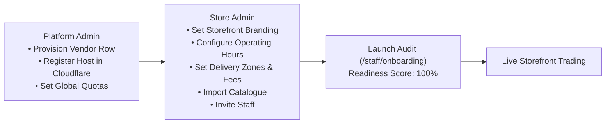

# Client Onboarding & Store Launch Readiness

This guide outlines the complete onboarding journey required to set up, configure, audit, and launch a new store on the multi-tenant platform.

---

## 1. Onboarding Workflow Overview

Setting up a new storefront involves collaboration between the **Platform Administrator** (technical infrastructure) and the **Store Administrator** (commercial operations):

---

## 2. Store Administrator Setup Sequence

### Phase 1: Storefront Profile & Branding
Navigate to `/staff/storefront`.
1. **Trading Details:** Set your store name, locality description (e.g., "Reading & East London"), and support WhatsApp number.
2. **Weekly Trading Hours:** Configure standard opening and closing times for each day of the week.
3. **Special Overrides:** Add temporary holiday closures or special operating schedules.

### Phase 2: Delivery Areas & Minimums
Navigate to `/staff/delivery-areas`.
1. **Postcode Outcodes:** Add the postcode prefixes your store delivers to (e.g. `E1`, `RG1`). Any shopper outside these areas will be refused delivery at checkout.
2. **Delivery Fees & Minimums:** Configure the standard delivery fee (in pence) and the minimum cart threshold required for delivery.
3. **Free Delivery Threshold:** Set an optional basket threshold at which delivery becomes free.

### Phase 3: Fulfilment Slots
Navigate to `/staff/fulfilment`.
1. **Delivery Slots:** Define recurring delivery time windows (e.g., 10:00–12:00, 14:00–17:00).
2. **Click & Collect:** Enable store collection slots and set preparation lead times.

### Phase 4: Product Catalogue Population
Navigate to `/staff/products` and `/staff/products/import`.
1. **Bulk Upload:** Upload your product list using Excel (`.xlsx`/`.xls`). Download the standard column template from the import screen.
2. **Categories & Brands:** Verify department hierarchies (`/staff/categories`) and brand assignments (`/staff/brands`).
3. **Net Content Review:** Check AI-suggested pack sizes in `/staff/net-content` before publishing.

### Phase 5: Team & Access
Navigate to `/staff/team`.
1. **Invite Staff:** Add team members by email and assign `STAFF` or `ADMIN` roles.
2. **Access Control:** Staff members can fulfill orders and update live stock, but cannot alter banking, branding, or team settings.

### Phase 6: Storefront FAQs & Help
Navigate to `/staff/faqs`.
1. **Customer Answers:** Add answers to common shopper questions (returns, delivery times, payment options).
2. **Storefront Assistant:** Toggle the AI/WhatsApp help assistant on or off in `/staff/assistant`.

---

## 3. Launch Readiness Audit (`/staff/onboarding`)

Before public launch, open `/staff/onboarding` and verify that the 6 readiness dimensions are satisfied:

| Dimension | Mandatory Requirements | Status Check |
| :--- | :--- | :--- |
| **Store Profile** | Name, locality description, and WhatsApp number configured | Verified |
| **Operating Hours** | At least one active day with valid hours | Verified |
| **Delivery Areas** | At least one postcode prefix with fee & minimum order | Verified |
| **Fulfilment Slots** | At least one active delivery or collection slot | Verified |
| **Catalogue** | Minimum 10 active products in stock | Verified |
| **Team** | At least one active staff member invited | Verified |

When all criteria pass, the status badge updates to **"Ready for Storefront Launch"**.
