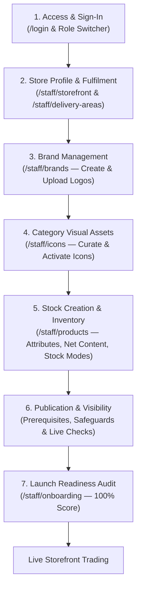

# Client Onboarding & Store Launch Readiness

This guide outlines the complete operational onboarding journey required to configure, populate, audit, and launch a store on the multi-tenant platform. It is designed to enable new staff members and store administrators to operate the platform independently.

---

## 1. Onboarding Workflow Overview

Setting up and managing a storefront follows a sequential operational workflow:

---

## 2. Sequential Staff Operational Walkthrough

### Step 1: System Access & Navigation
1. **Sign In:** Navigate to `/login`. Sign in using your store staff credentials (e.g. `staff@aheed.merqify.com`).
2. **Role Switcher:** Use the role switcher in the header chrome to toggle between:
   - **Shopper View (`/`):** The public-facing customer storefront.
   - **Staff View (`/staff`):** The operational portal for order processing and inventory.
   - **Admin View:** Accessible to store administrators for branding, banking, and team settings.
3. **Staff Overview Hub (`/staff`):** Provides real-time metrics, live order queues, and direct links to all operational modules.

---

### Step 2: Storefront Profile, Operating Hours & Fulfilment
Navigate to `/staff/storefront`, `/staff/delivery-areas`, and `/staff/fulfilment`:
1. **Trading Details:** Configure store display name, locality description (e.g., "Milton Keynes & Surrounding Areas"), and WhatsApp support line.
2. **Weekly Hours:** Set standard opening and closing times for each day of the week, plus holiday overrides.
3. **Delivery Postcodes:** In `/staff/delivery-areas`, add the postcode outcode prefixes your store delivers to (e.g. `MK1`, `MK2`). Unlisted postcodes are refused delivery at checkout.
4. **Delivery Fees & Minimums:** Set the standard delivery fee (e.g. £3.49), minimum basket value (e.g. £15.00), and free delivery spend threshold (e.g. £30.00).
5. **Fulfilment Slots:** In `/staff/fulfilment`, define morning/afternoon delivery windows and collection lead times.

---

### Step 3: Brand Creation & Management (`/staff/brands`)
Brands power customer facet filters on search and department browsing.
1. **Browse Brand Ledger:** Open `/staff/brands` to view all active brands, total linked products, and logo coverage.
2. **Create New Brand:** Click **Add Brand**, enter the brand name (e.g. *TRS*, *Fudco*, *East End*). The URL-friendly slug is created automatically.
3. **Upload Brand Logo:**
   - Click the upload icon on any brand card or row.
   - Select a high-resolution logo image (`.png`, `.webp`, or `.jpg`) to upload via `/api/admin/brands/upload-logo`.
   - Alternatively, enter a direct URL to ingest authentic manufacturer artwork.
4. **Inspect Linked Products (Quick-View Drawer):**
   - Click **Quick View** on any brand row.
   - A slide-out drawer displays all products currently linked to that brand, complete with live prices and stock levels.
   - If a product was mistakenly mapped, click **Unassign** inside the drawer to remove the brand association immediately.
5. **Delete Brand Safeguard:** To delete an unused brand, click **Delete**. If products are currently linked, the system requires checking a confirmation safety box before proceeding.

---

### Step 4: Category Visual Assets & Icon Gallery (`/staff/icons`)
Visual assets provide clear, polished navigation for shoppers across all departments and UI slots.
1. **Access Visual Asset Gallery:** Open `/staff/icons`. The gallery organizes visual assets into tabs:
   - *All Assets*
   - *Departments* (Category imagery)
   - *System 3D Icons* (Delivery van, storefront, quick shop, secure checkout)
   - *Flat Icons* (Functional icons)
   - *Brand Logos* (Uploaded and generated brand assets)
2. **Generate New Candidate Imagery:**
   - In the **Quick Asset Generator**, select the target type (*Category*, *System Slot*, or *Brand*).
   - Choose visual style: **Realistic Commercial Photo** (studio grocery photography on pure white `#ffffff`) or **3D Tactile Icon** (isometric clay-smooth 3D icon).
   - Click **Generate Asset**. The system renders a new variation via Cloudflare Workers AI in ~3–4 seconds.
3. **Activate Assets:**
   - Click **Activate** on any generated candidate card.
   - The asset is marked active (`CategoryAsset.isSelected = true`), immediately updates `Category.imageKey`, and reflects live across customer navigation.
4. **Deactivate vs Delete:**
   - **Deactivate:** Reverts the slot or category to the default static icon without removing the artwork from storage.
   - **Delete:** Permanently removes the asset from R2 storage and the relational asset ledger.
5. **Quick View:** Click any asset card to open the 320px high-resolution medallion Quick View, preview theme tint effects (*Action*, *Accent*, *Danger*), and view live storefront surfaces affected.

---

### Step 5: Stock Creation, Editing & Managing Attributes (`/staff/products`)
Add new items or edit existing catalogue rows:
1. **Access Product Editor:** Go to `/staff/products` and click **New Product** (`/staff/products/new`) or click **Edit** on an existing item (`/staff/products/[id]`).
2. **Mandatory Fields:**
   - **Product Name:** Clear, customer-facing title (e.g., *TRS Basmati Rice 5kg*).
   - **Category:** Select the parent department or subcategory.
   - **Base Price:** Enter selling price in pence (e.g. £4.99 is entered as `499`).
3. **Assign Brand:**
   - Select the brand from the searchable dropdown. The brand will immediately link to the product and appear as a clickable filter facet for shoppers.
4. **Net Content & Unit Pricing:**
   - Enter net content amount and unit (e.g. `500` and `g`, or `2` and `L`).
   - The system automatically derives the unit price (e.g. `£0.50 / 100g`) required by UK consumer regulations.
5. **Dietary & Quality Badges:**
   - Enable relevant badges: *Halal*, *100% Certified HMC* (with certification reference), *Fresh Produce*, *Organic*, *Vegetarian*, or *Gluten-Free*.
6. **VAT Rate Compliance:**
   - Select the verified VAT rate: `0%` (Zero-rated for domestic human food) or `20%` (Standard-rated for confectionery, hot food, alcohol, and non-food).
7. **Stock Tracking Modes:**
   - **TRACKED:** Enter physical shelf quantity (e.g. `50`) and low-stock warning threshold (e.g. `5`). Inventory automatically decrements on completed customer orders.
   - **UNTRACKED:** For items without inventory tracking that remain continuously available.
   - **INFINITE:** For staple lines with unlimited stock assurance.

---

### Step 6: Controlling Storefront Visibility & Publishing Items
Before an item appears publicly on `https://aheed.merqify.com/`, it must satisfy all publication rules:

| Publication Rule | Condition Required | Why It Matters |
| :--- | :--- | :--- |
| **Active Switch** | `isActive === true` | Master visibility toggle in product form or `/staff/inventory`. |
| **Parent Category Active** | `category.isActive === true` | If a department is disabled, all nested products are hidden. |
| **Positive Price** | `basePrice > 0` | Prevents £0.00 items from accidentally publishing to checkout. |
| **Stock Safeguard (#1449)** | Stock mode is **NOT** `UNKNOWN` | **Strict Safeguard:** The platform refuses to activate any product whose stock status is `UNKNOWN`. Operators must enter a verified stock count or set a mode (`TRACKED`/`UNTRACKED`) first. |
| **Purchasable Availability** | `stockQuantity > 0` (or `UNTRACKED`) | In `TRACKED` mode, items with 0 stock remain visible with an **"Out of Stock"** badge and disabled checkout button. |

---

## 3. Daily Staff Operational Procedures

### Order Fulfillment Routine
1. Open `/staff/orders` every 15 minutes during trading hours.
2. Advance orders from **CONFIRMED** to **PREPARING** when picking starts.
3. Advance to **OUT_FOR_DELIVERY** when handed to the local driver.
4. Advance to **DELIVERED** upon delivery completion.

### Live Shelf Stock Adjustments (`/staff/inventory`)
1. During busy trading rushes, open `/staff/inventory`.
2. Toggle items out of stock with one click if depleted from the shop floor.
3. Use quick increment/decrement buttons (`+1`, `-1`, `+10`) to reconcile shelf stock without opening the full product form.

---

## 4. Launch Readiness Audit (`/staff/onboarding`)

Before commencing public trading, open `/staff/onboarding` and confirm that all 6 readiness dimensions show green checks:

| Dimension | Mandatory Requirements | Status Check |
| :--- | :--- | :--- |
| **Store Profile** | Name, locality description, and WhatsApp number configured | Verified |
| **Operating Hours** | At least one active day with valid hours | Verified |
| **Delivery Areas** | At least one postcode prefix with fee & minimum order | Verified |
| **Fulfilment Slots** | At least one active delivery or collection slot | Verified |
| **Catalogue & Brands** | Minimum 10 active products in stock, brands assigned, and category icons set | Verified |
| **Team & Access** | At least one active staff member invited | Verified |

When all criteria pass, the status badge displays **"Ready for Storefront Launch"** (100% completion).
