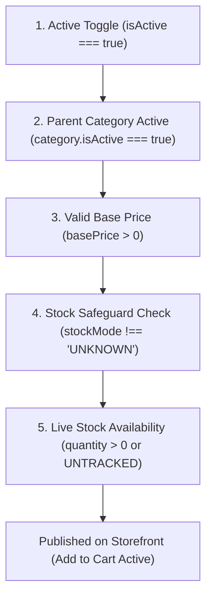

# Products & Catalogue Management Guide

This guide details product creation, brand management, category assignment, pricing and VAT compliance, stock controls, and publication rules for making items visible to customers.

---

## 1. Product Structure & Mandatory Fields

Every product in the catalogue enforces strict data consistency rules:

- **Product Name (Required):** Clear, customer-facing title (e.g. *East End Whole Jeera 100g*).
- **Category (Required):** Must be assigned to an active department or subcategory.
- **Pricing (Required):** Stored internally as integer pence (e.g. £3.49 is stored as `349`). Floating-point currency values are never stored.
- **Brand (Optional but Recommended):** Links the product to a brand entity in `/staff/brands` for faceted storefront filtering.
- **Net Content & Unit Pricing:** Physical volume or weight (e.g. `500` and `g`, or `1` and `L`). The system automatically derives the unit price (e.g. `£0.70 / 100g`) required by UK trade regulations.
- **Dietary & Quality Badges:** Supports verified retail badges:
  - *Halal*
  - *100% Certified HMC* (with certification reference code and verification timestamp)
  - *Fresh Produce*
  - *Organic*
  - *Vegetarian*
  - *Gluten-Free*
- **VAT Rate Compliance:** Select either `0%` (Zero-rated for domestic human food under HMRC Notice 701/14) or `20%` (Standard-rated for confectionery, savory snacks, alcohol, pet food, and non-food items).
- **Product Images:** Image keys are relative storage paths (e.g. `products/{id}/{uuid}.jpg`) stored in Cloudflare R2 object storage. Full URLs are composed dynamically at runtime via `CDN_BASE_URL`.

---

## 2. Stock Tracking Modes & Safeguards

The platform supports three distinct stock tracking modes for every product:

| Stock Mode | Operational Behavior | Use Case |
| :--- | :--- | :--- |
| **TRACKED** | Maintains an exact numerical inventory count (`stockQuantity`). Automatically decrements on completed customer orders. Generates low-stock alerts when remaining quantity falls below `lowStockThreshold`. | Fresh meat, boxed goods, limited-quantity inventory. |
| **UNTRACKED** | Product remains continuously available to buy without decrementing inventory. | High-turnover daily produce, freshly baked items replenished continuously. |
| **INFINITE** | Unlimited availability with guaranteed stock assurance. | Core proprietary lines, vendor staple essentials. |

### The Stock Safeguard Rule (#1449)
To prevent unverified spreadsheet rows from accidentally publishing to the storefront with corrupted stock:
> **Strict Guardrail:** The system **refuses to activate** any product whose stock status is `UNKNOWN`.  
> An operator cannot set `isActive: true` while the product has unverified stock. You must enter a verified numerical stock quantity or select an active stock mode (`TRACKED` or `UNTRACKED`) before activation can be saved.

---

## 3. Brand Management & Assignment (`/staff/brands`)

Brands provide a vital storefront navigation facet, allowing shoppers to filter search results and category aisles by their favorite producers (e.g. *TRS*, *Fudco*, *Aynoor*, *KTC*).

### 3.1 Managing Brands
Navigate to `/staff/brands`:
- **Create Brand:** Click **Add Brand**, enter the name, and save.
- **Upload Brand Logo:** Click the upload icon on any brand card to upload an authentic logo file (`.png`, `.webp`, `.jpg`), or enter a manufacturer image URL.
- **Brand Metrics:** View total linked products and active catalogue coverage.
- **Delete Brand Safeguard:** To prevent accidental orphaned records, deleting a brand with linked products requires checking an explicit confirmation safety checkbox.

### 3.2 Assigning Brands to Products
- **Individual Products:** Open any product in `/staff/products/[id]`, select the brand from the **Brand** dropdown, and click **Save**.
- **Quick-View Drawer (`/staff/brands`):** Click **Quick View** on any brand row in the Brand Table to slide out all associated products. If a product was misassigned, click **Unassign** inside the drawer to instantly unlink it.

---

## 4. How to Publish Stock & Control Storefront Visibility

For a product to be publicly visible and purchasable on `https://aheed.merqify.com/`, it must satisfy all 5 publication criteria:

### Publication Criteria Checklist:
1. **Active Toggle:** `isActive` must be set to `true`.
2. **Parent Category Active:** The category the product belongs to must have `isActive: true` in `/staff/categories`. Disabling a category hides all nested items.
3. **Valid Price:** `basePrice` must be greater than £0.00.
4. **Verified Stock Safeguard:** Stock status cannot be `UNKNOWN`.
5. **In-Stock vs Out-of-Stock:**
   - In `TRACKED` mode, items with `stockQuantity > 0` display the active **"Add to Cart"** button.
   - When quantity reaches `0`, the product remains browsable in the catalogue but displays an **"Out of Stock"** badge and disables checkout additions.

---

## 5. Live Inventory Quick Controls (`/staff/inventory`)

During busy trading hours, store staff can update inventory without opening full product forms:
- **Instant Availability Toggle:** One-click toggle to mark an item as out of stock.
- **Quick Adjusters:** Use `+1`, `-1`, and `+10` buttons to update shelf quantities in real time.
- **Low Stock Highlights:** Items below their configured threshold are highlighted in amber for priority restocking.

---

## 6. Bulk Excel Import (`/staff/products/import`)

When loading large catalogues:
1. Download the standard `.xlsx` template from `/staff/products/import`.
2. Populate required columns: `Product Name`, `Category`, `Price (£)`.
3. Optional columns: `Subcategory`, `Brand`, `Barcode`, `Stock Level`, `Unit / Net Content`.
4. Review pre-flight validation errors (duplicate barcodes, non-numeric prices) before committing.
