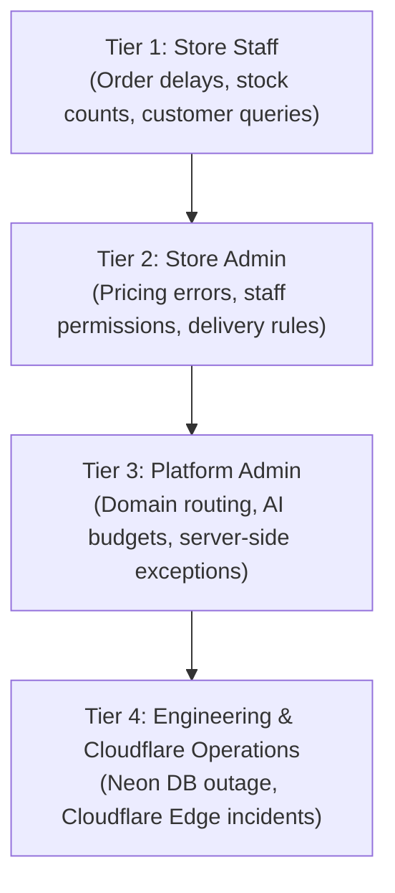

# Store Operations Troubleshooting & Escalation Matrix

This guide provides structured diagnostic workflows for common operational and technical incidents.

---

## 1. Issue Matrix: Symptoms, Causes, & Solutions

| Symptom | Probable Cause | Corrective Action | Who Resolves |
| :--- | :--- | :--- | :--- |
| **Customer checkout blocked: "Delivery not available"** | Postcode prefix is not registered in `/staff/delivery-areas`. | Check customer outcode prefix; add prefix to active delivery zones or ask customer to select Click & Collect. | Store Admin |
| **Customer cannot checkout: "Minimum order not reached"** | Cart total is lower than store minimum. | Advise customer to add items until cart exceeds the minimum threshold configured in `/staff/delivery-areas`. | Staff / Customer |
| **Excel stock upload fails with error** | Spreadsheet has invalid price strings (e.g. `$2.50`) or missing required headers. | Remove currency symbols; ensure headers match template: `Product Name`, `Category`, `Price (£)`. | Store Admin |
| **AI pack size extraction paused** | Store daily neuron budget exceeded or AI set to 0. | Check `/staff/ai-usage`. If budget is exhausted, request platform admin to increase neuron cap. | Platform Admin |
| **Storefront returns 500 error on new domain** | Hostname missing from Cloudflare Worker routes in `wrangler.toml`. | Check `/staff/platform/domains`. Ensure route is added to Worker config and redeployed. | Platform Admin |
| **Payment failed / card declined** | Insufficient funds or 3D Secure verification failure. | Check `/staff/payments`. View rejected event details. Direct customer to contact card issuer. | Store Admin / Staff |

---

## 2. Escalation Hierarchy

When an issue cannot be resolved through store-level controls, escalate according to the following procedure:

### Escalation Guidance
1. **Tier 1 → Tier 2:** Staff reports delivery rule anomalies or persistent stock import failures to Store Admin.
2. **Tier 2 → Tier 3:** Store Admin contacts Platform Admin for custom domain DNS issues, database connection errors, or quota adjustments.
3. **Tier 3 → Tier 4:** Platform Admin escalates unhandled server crashes found in `/staff/errors` to engineering via GitHub issue.
