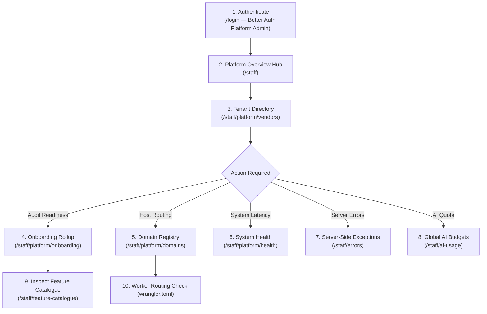
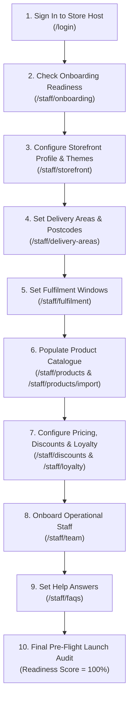
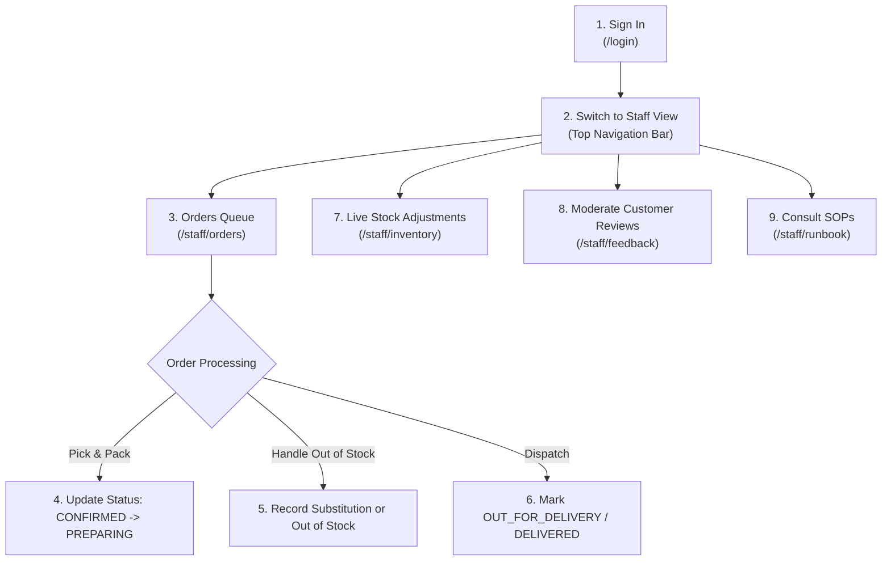
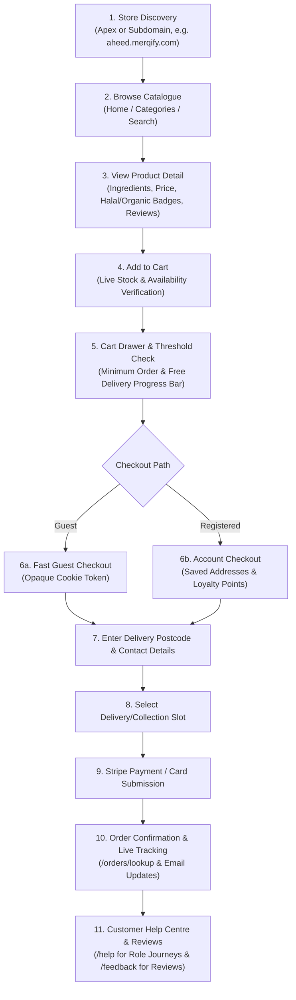
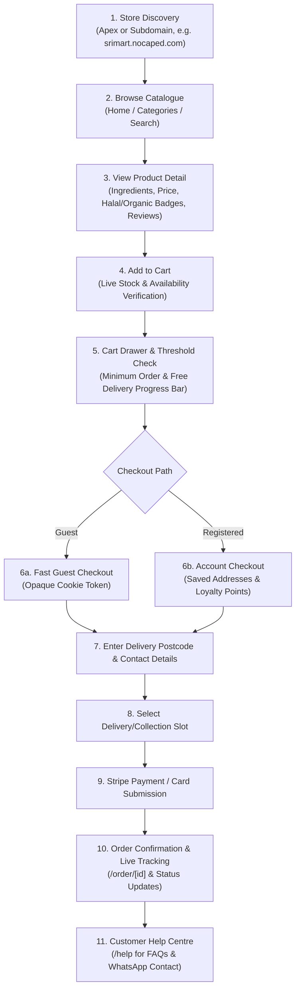

# Client & Role User Journey Maps

This document provides verified, step-by-step user journey maps for all four roles on the multi-tenant platform: **Platform Admin**, **Store Admin (Vendor Admin)**, **Store Staff**, and **Customer (Shopper)**.

Every journey is verified against the actual platform codebase, database schema, route gates, and UI workflows.

---

## 1. Platform Admin Journey

### 1.1 Goal & Starting Point
- **Goal:** Set up and monitor multi-tenant infrastructure, verify vendor onboarding readiness, manage host routing, monitor serverless system health, and govern global AI allowances.
- **Starting Point:** Accessing apex domain or custom host with global platform admin credentials (`User.role === 'ADMIN'`).

### 1.2 Visual Flow Diagram

### 1.3 Step-by-Step Sequence
1. **Sign-In:** Navigate to `/login`. Sign in using credentials for an account having global `Role.ADMIN` (e.g. `demo-platform-admin@merqify.com`).
2. **Access Platform Hub:** Open `/staff`. The Overview Hub displays both standard store links and the restricted **Platform Administration** cards (`/staff/platform/*`).
3. **Audit Tenant Directory (`/staff/platform/vendors`):** Review all registered store tenants. Check trading status (`ACTIVE` vs `SUSPENDED`), canonical domains, catalogue metrics, and delivery coverage counts.
4. **Review Multi-Tenant Onboarding Rollup (`/staff/platform/onboarding`):** Check launch-readiness scores for every tenant. Confirm that both store-operator items and platform-admin prerequisites (domains, email verification, payment gateway) are configured.
5. **Manage Domain Registry (`/staff/platform/domains`):** Verify incoming hostname mappings (`VendorDomain`). Confirm that each store has exactly one canonical domain and verify DNS resolution.
6. **Inspect System Health (`/staff/platform/health`):** Check live pooled Neon PostgreSQL connection ping latency and verify database isolate connectivity.
7. **Inspect Error Events (`/staff/errors`):** Review the 50 most recent server-side exceptions, HTTP status codes, and error digests to address tenant issues before they escalate.
8. **Govern AI Budget (`/staff/ai-usage`):** On any tenant host, configure daily neuron limits (up to 1,000,000) and verify the Cloudflare `WORKERS_AI_PLAN` setting (`free` vs `paid`).
9. **Review Implemented Features (`/staff/feature-catalogue`):** Inspect the role-organized Feature Catalogue (Customer, Admin, Staff, Platform Admin) to verify feature completeness, demo talking points, and launch readiness.

### 1.4 Required Permissions & Prerequisites
- `requirePlatformAdmin()` or `requireVendorRole` resolving `via: "platform-admin"`.
- User account having `User.role === 'ADMIN'`.

### 1.5 Decisions, Alternative Paths, & Common Errors
- **Error: 403 Forbidden on `/staff/platform/*`:** The user account possesses `VendorRole.ADMIN` (Store Admin) rather than global `Role.ADMIN`. Re-authenticate with a platform administrator account.
- **Domain not resolving live traffic:** The domain was inserted into `VendorDomain` in PostgreSQL but was omitted from the Cloudflare Worker routes in `wrangler.toml`.

### 1.6 Onboarding & Completion Checklist
- [ ] Platform administrator session verified.
- [ ] Tenant database row exists with valid slug and trading name.
- [ ] Canonical domain mapped in `VendorDomain` and registered in `wrangler.toml`.
- [ ] Onboarding rollup reflects 100% platform configuration readiness.
- [ ] Error logs in `/staff/errors` checked for unhandled exceptions.
- [ ] Cloudflare R2 bucket CORS configured for presigned image uploads.

---

## 2. Store Admin (Vendor Admin) Journey

### 2.1 Goal & Starting Point
- **Goal:** Autonomously configure a tenant store, establish delivery zones, import products, customize and manage storefront themes, invite staff, set up customer FAQs, and achieve 100% launch readiness.
- **Starting Point:** Accessing the store URL (e.g., `aheed.merqify.com/staff` or `srimart.merqify.com/staff`) with store admin credentials.

### 2.2 Visual Flow Diagram

### 2.3 Step-by-Step Sequence
1. **Sign-In:** Access `/login` on the vendor's domain. User holds `VendorMembership` with `role: ADMIN` for that `vendorId`.
2. **Onboarding Readiness Audit (`/staff/onboarding`):** Review the 6 launch-critical sections: Store Profile, Operating Hours, Delivery Areas, Fulfilment Slots, Product Catalogue, and Staff Team.
3. **Storefront Branding & Themes (`/staff/storefront`):**
   - Upload Logo and Square Mark (used for favicon, mobile touch icon, and social previews).
   - Select and apply a global preset theme or custom saved theme.
   - Adjust individual brand colors (green, orange, red, cream, and tints) and save custom themes.
   - **Delete Custom Themes:** Select any custom saved theme and click **Delete Theme** to remove unused palettes. Global presets remain permanently available and protected.
   - Configure weekly trading hours, collection lead times, and holiday overrides.
4. **Delivery Areas & Postcodes (`/staff/delivery-areas`):** Define covered postcode prefixes (e.g. `E1`, `E2`), minimum basket thresholds, standard delivery fees, and free-delivery thresholds.
5. **Fulfilment Windows (`/staff/fulfilment`):** Configure standard delivery windows, click-and-collect time slots, and express collection lead times.
6. **Catalogue Management (`/staff/products` & `/staff/products/import`):** Add individual items or upload bulk inventory spreadsheets (`.xlsx`/`.xls`). Review barcode matches, VAT rates, and net-content suggestions (`/staff/net-content`).
7. **Discounts & Loyalty (`/staff/discounts`, `/staff/loyalty`):** Set up promotional coupon codes, percentage/fixed discounts, customer referral codes, and optional loyalty tier point multipliers.
8. **Invite Team (`/staff/team`):** Invite staff members, assign `STAFF` vs `ADMIN` roles, or revoke access.
9. **Help & FAQs (`/staff/faqs`):** Author store-specific answers to common customer questions. Toggle Storefront Assistant (`/staff/assistant`) on/off.
10. **Review Feature Catalogue (`/staff/feature-catalogue`):** Explore live and planned features, business benefits, and demonstration talking points across all user tiers.
11. **Launch:** Verify `/staff/onboarding` displays "Ready for Storefront Launch" (100% completion).

### 2.4 Required Permissions & Prerequisites
- `requireVendorRole("ADMIN")`.
- Scoped strictly to `vendorId` of the current tenant host. Cross-tenant access is blocked with HTTP 403.

### 2.5 Decisions, Alternative Paths, & Common Errors
- **Error: Theme deletion refused:** Only custom themes created by your store can be deleted. Platform global presets cannot be removed.
- **Error: Excel import fails:** Ensure file contains mandatory columns (Name, Price, Category) and that prices are formatted as numeric values (parsed to integer pence). Download the template from `/staff/products/import`.
- **Customer unable to checkout due to postcode:** Ensure outcode prefix is registered in `/staff/delivery-areas`.

### 2.6 Onboarding & Completion Checklist
- [ ] Storefront name, locality, logo, square mark, and WhatsApp contact configured.
- [ ] Brand theme chosen or custom theme saved; unwanted custom themes pruned.
- [ ] Weekly operating hours and delivery schedules saved.
- [ ] Delivery area postcode prefixes, minimum order, and fees set.
- [ ] At least 10 active products published across valid categories.
- [ ] At least one staff member account invited.
- [ ] Storefront FAQs authored and published.
- [ ] `/staff/onboarding` displays "Ready for Storefront Launch".

---

## 3. Store Staff Journey

### 3.1 Goal & Starting Point
- **Goal:** Fulfill incoming orders, adjust immediate stock availability, handle item substitutions, moderate feedback, and follow operational runbooks.
- **Starting Point:** Vendor staff login at `/staff/orders`.

### 3.2 Visual Flow Diagram

### 3.3 Step-by-Step Sequence
1. **Sign-In:** Log in at `/login`. User holds `VendorMembership` with `role: STAFF` or `role: ADMIN`.
2. **Access Orders Queue (`/staff/orders`):** Open active orders queue. Filter by status: `CONFIRMED`, `PREPARING`, `OUT_FOR_DELIVERY`.
3. **Picking & Packing:** Open order details. Review customer requested items, pack list, and delivery slot. Update status from `CONFIRMED` to `PREPARING`.
4. **Handling Stock Shortages:** If an item is unavailable, toggle item status or adjust inventory directly in `/staff/inventory`. Contact customer via phone/WhatsApp if necessary.
5. **Dispatch & Completion:** When courier collects or driver departs, advance order to `OUT_FOR_DELIVERY`. Mark `DELIVERED` upon handover.
6. **Live Inventory Quick Toggles (`/staff/inventory`):** Toggle products out of stock with one click during store rushes to immediately hide or disable them on the customer storefront.
7. **Customer Reviews Moderation (`/staff/feedback`):**
   - When shoppers leave feedback on `/feedback`, reviews land in `PENDING` status.
   - Check customer ratings, written reviews, and verified purchase flags.
   - Click **Approve** (or **Approve all waiting**) to publish reviews to the homepage 3D carousel.
   - Click **Reject** for spam, abuse, or personal information. Un-approving immediately removes a review from public display.
8. **Consult Runbook (`/staff/runbook`):** When encountering an operational question (e.g. damaged goods, delivery dispute), consult the in-app runbook filtered to Staff SOPs.

### 3.4 Required Permissions & Prerequisites
- `requireVendorRole("STAFF", "ADMIN")`.
- Staff accounts are restricted from Admin-only settings (`/staff/team`, `/staff/storefront`, `/staff/discounts`, `/staff/reports`, `/staff/onboarding`).

### 3.5 Onboarding & Completion Checklist
- [ ] Staff credentials verified and linked to correct store.
- [ ] First test order transitioned through all statuses (`CONFIRMED` → `PREPARING` → `OUT_FOR_DELIVERY` → `DELIVERED`).
- [ ] Live stock toggle tested on a product in `/staff/inventory`.
- [ ] Customer feedback queue reviewed and approved.
- [ ] Staff SOP runbook bookmarked.

---

## 4. Customer (Shopper) Journey

### 4.1 Goal & Starting Point
- **Goal:** Discover store, browse groceries, verify delivery eligibility, apply promotional discounts or loyalty points, complete secure checkout, and track delivery.
- **Starting Point:** Visiting vendor storefront URL (e.g. `aheed.merqify.com`).

### 4.2 Visual Flow Diagram

### 4.3 Step-by-Step Sequence
1. **Store Discovery & Branding:** Customer arrives on tenant storefront. The site automatically renders tenant branding, logo, and active banner promotions based on request host header.
2. **Catalogue Navigation:** Browse categories (Fresh Produce, Dairy, Bakery, etc.), search by keyword (`/search`), or filter by attributes (Halal, Organic, Brand). Use Shop Your List (`/shop-your-list`) to paste ingredient lists for automated basket building.
3. **Product Detail Inspection:** Check product pricing (formatted in GBP £), pack sizes, customer reviews, and real-time inventory availability.
4. **Cart Management:** Add items to cart. The application checks stock limits; if a customer requests 5 units but only 3 exist, the feedback badge confirms "Added 3 (maximum stock available)".
5. **Delivery Threshold Guidance:** Open cart drawer. Live banner indicates progress toward minimum order and free delivery threshold.
6. **Checkout Initiation (`/checkout`):**
   - Option A: Guest checkout (no account creation required).
   - Option B: Sign in with Better Auth to redeem loyalty points and use saved addresses.
7. **Address & Delivery Eligibility:** Enter delivery postcode. Postcode prefix is verified against `VendorDeliveryArea`. If outside delivery zone, customer is prompted with collection option or informed of delivery boundary.
8. **Fulfilment Window:** Choose delivery date and time slot, or select click-and-collect.
9. **Discount / Referral:** Enter promotional or friend referral code. System applies instant price reduction and displays net total in pence.
10. **Secure Payment:** Card payment securely handled via Stripe Elements. Sensitive card data never touches the application servers.
11. **Confirmation & Tracking (`/orders/lookup`):** Immediate order confirmation page displaying order summary, delivery slot, and live status indicator (`PENDING_PAYMENT` -> `CONFIRMED` -> `PREPARING` -> `OUT_FOR_DELIVERY` -> `DELIVERED`).
12. **Help & Role Journeys (`/help`):** Shopper visits Help Centre for interactive User Journey Maps, delivery rules, FAQs, and WhatsApp support.
13. **Share Feedback (`/feedback`):** Customers can rate their shopping experience (1 to 5 stars) and write comments, displayed on the homepage 3D carousel once reviewed by store staff.

### 4.4 Required Permissions & Prerequisites
- Public access / Customer session.
- Valid delivery address within vendor's configured postcodes.

### 4.5 Onboarding & Completion Checklist
- [ ] Storefront URL loaded and verified with correct vendor branding.
- [ ] Product added to cart and verified against stock.
- [ ] Postcode validated against delivery zone rules.
- [ ] Checkout completed and order tracking link received.
- [ ] Customer feedback submitted.
5. **Fulfilment Windows (`/staff/fulfilment`):** Configure standard delivery windows, click-and-collect time slots, and express collection lead times.
6. **Catalogue Management (`/staff/products` & `/staff/products/import`):** Add individual items or upload bulk inventory spreadsheets (`.xlsx`/`.xls`). Review barcode matches, VAT rates, and net-content suggestions (`/staff/net-content`).
7. **Discounts & Loyalty (`/staff/discounts`, `/staff/loyalty`):** Set up promotional coupon codes, percentage/fixed discounts, customer referral codes, and optional loyalty tier point multipliers.
8. **Invite Team (`/staff/team`):** Invite staff members, assign `STAFF` vs `ADMIN` roles, or revoke access.
9. **Help & FAQs (`/staff/faqs`):** Author store-specific answers to common customer questions. Toggle Storefront Assistant (`/staff/assistant`) on/off.
10. **Launch:** Verify `/staff/onboarding` displays "Ready for Storefront Launch" (100% completion).

### 2.4 Required Permissions & Prerequisites
- `requireVendorRole("ADMIN")`.
- Scoped strictly to `vendorId` of the current tenant host. Cross-tenant access is blocked with HTTP 403.

### 2.5 Decisions, Alternative Paths, & Common Errors
- **Error: Excel import fails:** Ensure file contains mandatory columns (Name, Price, Category) and that prices are formatted as numeric values (parsed to integer pence). Download the template from `/staff/products/import`.
- **Customer unable to checkout due to postcode:** Ensure outcode prefix is registered in `/staff/delivery-areas`.

### 2.6 Onboarding & Completion Checklist
- [ ] Storefront name, locality, and WhatsApp contact configured.
- [ ] Weekly operating hours and delivery schedules saved.
- [ ] Delivery area postcode prefixes, minimum order, and fees set.
- [ ] At least 10 active products published across valid categories.
- [ ] At least one staff member account invited.
- [ ] Storefront FAQs authored and published.
- [ ] `/staff/onboarding` displays "Ready for Storefront Launch".

---

## 3. Store Staff Journey

### 3.1 Goal & Starting Point
- **Goal:** Fulfill incoming orders, adjust immediate stock availability, handle item substitutions, moderate feedback, and follow operational runbooks.
- **Starting Point:** Vendor staff login at `/staff/orders`.

### 3.2 Visual Flow Diagram

### 3.3 Step-by-Step Sequence
1. **Sign-In:** Log in at `/login`. User holds `VendorMembership` with `role: STAFF` or `role: ADMIN`.
2. **Access Orders Queue (`/staff/orders`):** Open active orders queue. Filter by status: `CONFIRMED`, `PREPARING`, `OUT_FOR_DELIVERY`.
3. **Picking & Packing:** Open order details. Review customer requested items, pack list, and delivery slot. Update status from `CONFIRMED` to `PREPARING`.
4. **Handling Stock Shortages:** If an item is unavailable, toggle item status or adjust inventory directly in `/staff/inventory`. Contact customer via phone/WhatsApp if necessary.
5. **Dispatch & Completion:** When courier collects or driver departs, advance order to `OUT_FOR_DELIVERY`. Mark `DELIVERED` upon handover.
6. **Live Inventory Quick Toggles (`/staff/inventory`):** Toggle products out of stock with one click during store rushes to immediately hide or disable them on the customer storefront.
7. **Customer Reviews Moderation (`/staff/feedback`):** Review customer ratings and written comments. Approve appropriate reviews so they appear on product pages.
8. **Consult Runbook (`/staff/runbook`):** When encountering an operational question (e.g. damaged goods, delivery dispute), consult the in-app runbook filtered to Staff SOPs.

### 3.4 Required Permissions & Prerequisites
- `requireVendorRole("STAFF", "ADMIN")`.
- Staff accounts are restricted from Admin-only settings (`/staff/team`, `/staff/storefront`, `/staff/discounts`, `/staff/reports`, `/staff/onboarding`).

### 3.5 Onboarding & Completion Checklist
- [ ] Staff credentials verified and linked to correct store.
- [ ] First test order transitioned through all statuses (`CONFIRMED` → `PREPARING` → `OUT_FOR_DELIVERY` → `DELIVERED`).
- [ ] Live stock toggle tested on a product.
- [ ] Staff SOP runbook bookmarked.

---

## 4. Customer (Shopper) Journey

### 4.1 Goal & Starting Point
- **Goal:** Discover store, browse groceries, verify delivery eligibility, apply promotional discounts or loyalty points, complete secure checkout, and track delivery.
- **Starting Point:** Visiting vendor storefront URL.

### 4.2 Visual Flow Diagram

### 4.3 Step-by-Step Sequence
1. **Store Discovery & Branding:** Customer arrives on tenant storefront. The site automatically renders tenant branding, logo, and active banner promotions based on request host header.
2. **Catalogue Navigation:** Browse categories (Fresh Produce, Dairy, Bakery, etc.), search by keyword (`/search`), or filter by attributes (Halal, Organic, Brand).
3. **Product Detail Inspection:** Check product pricing (formatted in GBP £), pack sizes, customer reviews, and real-time inventory availability.
4. **Cart Management:** Add items to cart. The application checks stock limits; if a customer requests 5 units but only 3 exist, the feedback badge confirms "Added 3 (maximum stock available)".
5. **Delivery Threshold Guidance:** Open cart drawer. Live banner indicates progress toward minimum order and free delivery threshold.
6. **Checkout Initiation (`/checkout`):**
   - Option A: Guest checkout (no account creation required).
   - Option B: Sign in with Better Auth to redeem loyalty points and use saved addresses.
7. **Address & Delivery Eligibility:** Enter delivery postcode. Postcode prefix is verified against `VendorDeliveryArea`. If outside delivery zone, customer is prompted with collection option or informed of delivery boundary.
8. **Fulfilment Window:** Choose delivery date and time slot, or select click-and-collect.
9. **Discount / Referral:** Enter promotional or friend referral code. System applies instant price reduction and displays net total in pence.
10. **Secure Payment:** Card payment securely handled via Stripe Elements. Sensitive card data never touches the application servers.
11. **Confirmation & Tracking (`/order/[id]`):** Immediate order confirmation page displaying order summary, delivery slot, and live status indicator (`PENDING_PAYMENT` -> `CONFIRMED` -> `PREPARING` -> `OUT_FOR_DELIVERY` -> `DELIVERED`).
12. **Help & Inquiries (`/help`):** If questions arise, shopper visits Help Centre for vendor FAQs, delivery rules, or instant WhatsApp messaging.

### 4.4 Required Permissions & Prerequisites
- Public access / Customer session.
- Valid delivery address within vendor's configured postcodes.

### 4.5 Onboarding & Completion Checklist
- [ ] Storefront URL loaded and verified with correct vendor branding.
- [ ] Product added to cart and verified against stock.
- [ ] Postcode validated against delivery zone rules.
- [ ] Checkout completed and order tracking link received.
