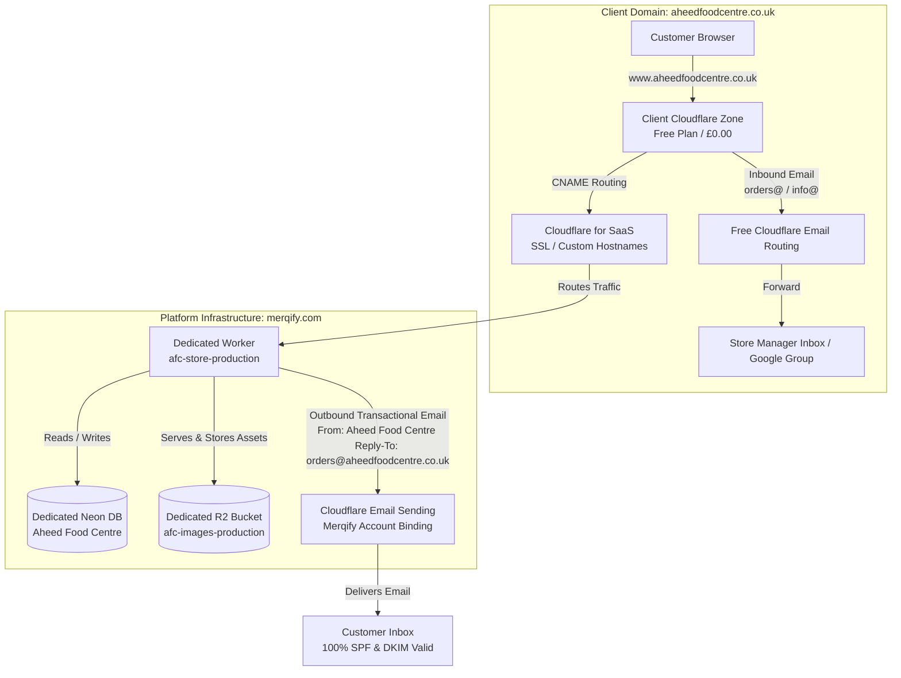

# SaaS Scaling, Cost Analysis & Resource Isolation Architecture
## Multi-Client Economics, Performance Isolation, Storage Partitioning & Email Topology

## 1. Executive Summary

This document codifies the operational and financial architecture for scaling independent client storefronts (such as **Aheed Food Centre**) on the centralized **Merqify SaaS Platform**.

By combining **Cloudflare for SaaS (Custom Hostnames)**, **dedicated Neon database cells (ADR-009)**, **partitioned Cloudflare R2 image storage**, and **platform transactional email delegation (Option 2)**, the platform delivers enterprise-grade physical data isolation and multi-tenant performance without multiplying fixed infrastructure subscriptions or fracturing CI/CD pipelines.

---

## 2. Platform Architecture Overview



---

## 3. Financial Model & Scaling Economics

A common concern in multi-tenant architectures is whether onboarding additional active clients will cause sudden compute and hosting cost spikes. In this architecture, infrastructure unit economics are strictly sub-linear: **marginal cost per client decreases as the client base expands**.

### 3.1 Resource Cost Schedule

| Infrastructure Layer | Plan Baseline | Usage Allowance Included | Over-Quota Rate |
| :--- | :--- | :--- | :--- |
| **Cloudflare Workers** | $5.00 / month | 10,000,000 requests/mo<br>30,000,000 CPU ms/mo | $0.30 per 1M requests<br>$0.02 per 1M CPU ms |
| **Cloudflare for SaaS** | Included | 100 Custom Hostnames (50 client domains) | $0.10 / hostname / mo |
| **Cloudflare R2 Storage** | Free tier / usage | 10 GB storage<br>10M Class B (read) ops/mo | $0.015 / GB-month<br>**Zero egress / bandwidth fees** |
| **Cloudflare Email Sending** | Included in Workers Paid | 3,000 outbound emails / month | $0.35 per 1,000 emails |
| **Neon PostgreSQL** | Free / usage tier | Dedicated connection pool per cell | Compute auto-scales to zero at idle |

### 3.2 Projected Costs at Scale

| Scale Tier | Estimated Requests / Mo | Cloudflare Monthly Cost | Database Monthly Cost | Total Monthly Cost | Cost Per Client |
| :--- | :--- | :--- | :--- | :--- | :--- |
| **1 Client (Aheed Food Centre)** | ~250k reqs/mo | $5.00 (base) | Included / Free tier | **~$5.00** | ~$5.00 |
| **5 Clients** | ~1.5M reqs/mo | $5.00 (base) | ~$0 – $19 | **~$5.00 – $24.00** | ~$1.00 – $4.80 |
| **20 Clients** | ~8M reqs/mo | $5.00 (base) | Usage-based | **~$25.00 – $45.00** | ~$1.25 – $2.25 |
| **50 Clients** | ~25M reqs/mo | ~$9.50 | Usage-based | **~$65.00 – $110.00** | ~$1.30 – $2.20 |
| **100 Clients** | ~60M reqs/mo | ~$25.00 | Usage-based | **~$120.00 – $200.00** | ~$1.20 – $2.00 |

> [!NOTE]
> Even at 50 active clients generating 25 million monthly edge requests, the Cloudflare compute and SaaS bill is less than $10/month because of the 10M base allowance and $0.30/million overage pricing.

---

## 4. Noisy-Neighbor Protection & Resource Isolation

To protect system reliability when multiple clients trade concurrently, three layers of isolation are enforced:

### 4.1 Compute Isolation (V8 Edge Isolates)
Unlike containerized clusters where CPU-intensive queries can starve sibling applications, Cloudflare Workers operate on Google V8 isolates. When Client A receives a massive flash sale or seasonal rush, Cloudflare dynamically scales isolates dedicated exclusively to Client A's Worker routes. Client B’s Worker routes execute in parallel isolates with zero thread contention or CPU starvation.

### 4.2 Database Isolation (Dedicated Cells — ADR-009)
Dedicated clients do not share Postgres tables, foreign keys, or database connection pools with other tenants.
- **Independent Connection String:** `afc-store-*` workers connect exclusively to the dedicated `Aheed Food Centre` Neon project via `AFC_DATABASE_URL`.
- **Query Lock Containment:** Long-running analytical queries, bulk stock updates, or checkout transactions on one client database cannot lock rows or exhaust connection pools on any other database.
- **Data Sovereignty:** Client data can be backed up, migrated, or purged independently to satisfy audit and compliance mandates.

### 4.3 Media Storage Partitioning (Dedicated R2 Buckets)
To eliminate any hazard of cross-tenant image mixups, accidental overwrites, or asset naming collisions, media storage is strictly partitioned per client cell:
- Platform Cell: `shoplocal-images-staging` and `shoplocal-images-production`
- Aheed Food Centre Cell: `afc-images-staging` and `afc-images-production`
- Each environment specifies its dedicated bucket in `wrangler.toml` (`[[env.afc-*.r2_buckets]]`) and runtime secrets (`S3_BUCKET`).
- Product graphics, department banners, and branding assets are uploaded directly into the tenant's dedicated bucket.
- Because Cloudflare R2 has zero bandwidth egress fees, serving high-resolution product photography never incurs variable bandwidth surcharges.

---

## 5. Email Topology: Option 2 (Platform Delegated Sender)

To avoid forcing every client account to purchase an independent $5/month Workers Paid subscription merely to send transactional emails, the platform adopts **Option 2 (Platform Delegated Sender)**:

### 5.1 Outbound Sending Strategy
- **Worker Configuration:** Dedicated workers declare `EMAIL_FROM = "no-reply@merqify.com"`.
- **Display Name:** Dynamically resolved from the tenant branding (`from.name = "Aheed Food Centre"`).
- **Reply-To Routing:** Automatically set to the store's designated support address (`Reply-To: orders@aheedfoodcentre.co.uk`).
- **DKIM & SPF Alignment:** Because `merqify.com` has active Email Sending credentials in the primary Cloudflare account, 100% of outbound receipts, verification links, and dispatch alerts pass SPF and DKIM authentication. Customer inboxes display:
  ```text
  From: Aheed Food Centre <no-reply@merqify.com>
  Reply-To: orders@aheedfoodcentre.co.uk
  Subject: Order Confirmation #1042 · Aheed Food Centre
  ```

### 5.2 Inbound Routing Strategy
- **Cloudflare Email Routing:** Hosted entirely on the client's free Cloudflare zone (`aheedfoodcentre.co.uk`) at **£0.00**.
- **Rule Configuration:**
  - `orders@aheedfoodcentre.co.uk` → forwards to the store manager's Gmail or Google Group (`info-afc@googlegroups.com`).
  - `info@aheedfoodcentre.co.uk` → forwards to customer support.
- When customers reply to automated transactional emails, replies flow directly into the store manager's existing inbox without touching the platform application servers.

---

## 6. Standard Operating Checklist for Onboarding Future Clients

When adding Client #2, #3, etc. as dedicated cells:

1. **Database:** Create dedicated project in Neon; run migrations (`scripts/bootstrap-dedicated-cell.ts`).
2. **Storage:** Create dedicated R2 bucket `clientname-images-production` via Cloudflare API.
3. **Workers:** Add `[env.clientname-production]` in `wrangler.toml` pointing to `clientname-images-production` and `EMAIL_FROM = "no-reply@merqify.com"`.
4. **Cloudflare for SaaS:** Register custom hostname in `merqify.com` > SSL/TLS > Custom Hostnames.
5. **Client DNS:** Add CNAME `www` pointing to `fallback.merqify.com` and enable Free Email Routing for inbound mail.
