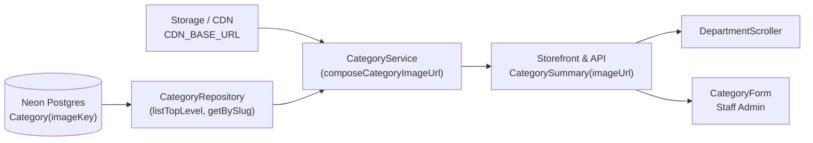

# Engineering Plan: Realistic Product Photography for Categories

**Tracking issue:** `#1278`  
**Slice:** `specs/2026-10-26-category-realistic-photography/`  
**Base branch:** `staging`  
**Feature branch:** `feature/category-realistic-photography`

---

## 1. Context & Motivation

On the live storefront (`https://staging.aheedfoodcentre.nocaped.com/`), categories currently render either synthetic 3D vector icons (`Icon3D`) or Noto Emoji illustrations (`public/illustrations/departments/*.svg`). These icons do not reflect the visual standard of tier-1 UK grocery retailers like Tesco, where shoppers navigate categories via real, appetizing product photographs (e.g. fresh bananas for Fresh Food, bread for Bakery, canned soup for Food Cupboard, detergent for Household).

Furthermore, `Category` in `prisma/schema.prisma` previously lacked an `imageKey` column, making it impossible for multi-tenant vendors to upload or configure category images via the database or receive them via APIs.

---

## 2. Architecture & Decisions

### 2.1 Database & Storage (ADR-003)
Per ADR-003:
- The database stores **relative storage keys** (`imageKey`), never full URLs.
- Keys are immutable: `categories/fruit-veg.webp`, `categories/bakery.webp`.
- URLs are composed at read time using `CDN_BASE_URL` or static public assets (`/images/categories/<slug>.webp`).

### 2.2 API & Data Flow

### 2.3 Photographic Standard (Tesco Model)
- Pure, clean backgrounds (white or transparent).
- Real grocery products with natural studio lighting.
- Optimized WebP format (averaging 15–30 KB per image) for sub-100ms transfer.
- Eager loading for above-the-fold items (first 6) and lazy loading with async decoding for remaining items.

---

## 3. Implementation Steps

1. **Schema & Migration:**
   - Update `prisma/schema.prisma` with `imageKey String?` on `Category`.
   - Create `prisma/migrations/20261026150000_category_image_key/migration.sql`.
   - Update `prisma/seed.ts` to assign image keys to all top-level categories.
2. **Photography Assets:**
   - Create WebP photographic assets for all 15 departments in `public/images/categories/`.
3. **Repository & Service Layer:**
   - Update `lib/repositories/categories.ts`: add `imageKey` and `imageUrl` to types, select `imageKey` in Prisma queries, add `composeCategoryImageUrl`.
   - Update `lib/categories-service.ts`: pass `CDN_BASE_URL` to category resolution.
   - Update `app/api/search/suggest/route.ts`: include `imageUrl`.
4. **UI Components:**
   - Update `DepartmentScroller.tsx` to render `category.imageUrl` inside styled photo cards.
   - Update `DepartmentGlyph.tsx` to use photographic images.
   - Update `CategoryForm.tsx` to display and edit `imageKey`.
5. **Documentation & Validation:**
   - Author KMS guide `docs/client-help-centre/category-image-standards.md`.
   - Run tests, `kms:validate`, `kms:build-index`, and verify storefront.
