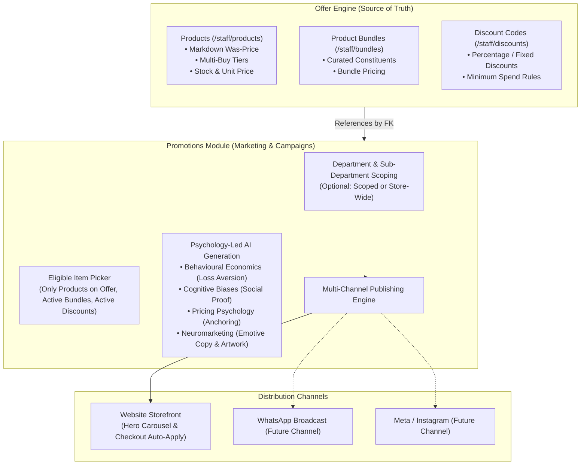

# Promotions: Marketing Campaign Management, Eligible Offer Items & AI Generation (plan)

## 1. Product Vision & Commercial Objectives

Promotions in modern e-commerce must balance commercial pricing integrity with high-converting marketing communication. In independent UK retail, confusing price configuration with marketing presentation leads to pricing drift, duplicated logic, and low conversion.

This slice cements the architectural principle:
**Keep offer configuration separate from marketing campaign management.**

1. **Offer Separation:** All commercial pricing and discounts are maintained strictly in `/staff/products`, `/staff/bundles`, and `/staff/discounts`. The Promotions module references existing entities by foreign key without duplicating pricing mathematics.
2. **Promotional Item Eligibility:** When selecting individual products to promote, the picker displays **only products with active promotional content** (Was-price markdown, active multi-buy, or featured status).
3. **Department Hierarchy:** Scopes promotions optionally to a department or sub-department via `toCategoryOptionGroups`, falling back to Store-wide when unselected.
4. **Checkout Auto-Application:** Automatically applies the highest-priority eligible promotion at checkout when cart criteria match.
5. **Psychology & Neuromarketing AI Generation:** Produces high-converting copy and banner imagery engineered with behavioural economics, cognitive biases, pricing psychology, and neuromarketing, accompanied by a clear explanatory disclosure.
6. **Multi-Channel Publishing Architecture:** Establishes channel categorization (`WEBSITE`, `WHATSAPP`, `FACEBOOK`, `INSTAGRAM`) to support omnichannel campaign dispatch.

---

## 2. Technical Architecture & Component Flow

### A. Staff Promotion Form (`components/staff/PromotionForm.tsx`)
The form sections are reorganized into a natural marketing workflow:
1. **Offer & Scope Selection:**
   - Department selector (`toCategoryOptionGroups`): Department + sub-department optgroups, with `-- Store-wide (All Departments) --` default.
   - Offer Type selector: Radio choices (`PRODUCT`, `BUNDLE`, `DISCOUNT_CODE`).
   - Dynamic filtered item picker:
     - `PRODUCT`: Dropdown of eligible products matching the chosen department, displaying exact savings (e.g. *Basmati Rice 5kg — Was £14.99, Now £11.99 (Save £3.00)* or *3 for £10.00*).
     - `BUNDLE`: Active bundles.
     - `DISCOUNT_CODE`: Active discount codes.
   - Channel selector: `WEBSITE` (default), with WhatsApp and Social media preview tabs.
2. **Scheduling & Prioritisation:**
   - Starts At and Ends At local datetime inputs.
   - Priority rank (0-1000).
   - Audience segment targeting (`ALL`, `NEW_CUSTOMER`, `RETURNING_CUSTOMER`, `LOYALTY_MEMBER`).
   - Active toggle.
3. **Promotional Messaging:**
   - Headline, Subtitle, Badge/Tag, Call to Action text.
4. **Visual Media & AI Generation:**
   - Prominent psychology callout note explaining the applied behavioural economics and neuromarketing principles.
   - "Generate Message and Banner Using AI" button triggering simultaneous copy and image generation.
   - Image upload, preview, and Alt Text.

### B. Checkout Auto-Application
In `app/(storefront)/checkout/page.tsx` and `lib/checkout-pricing.ts`:
- Server resolves live promotions for the current vendor ordered by `priority DESC`.
- Finds the first promotion that matches the cart:
  - If store-wide: matches any cart meeting minimum spend.
  - If scoped to a department/sub-department: matches if the cart contains at least one line item belonging to that category or its subcategories.
- If the matched promotion has a `discountCode`, it automatically calls `previewCheckoutCode` to prefill the discount, rendering an auto-applied promotion banner in checkout summary.

### C. AI Generation Pipeline
- Endpoint: `POST /api/admin/promotions/ai-generate`
- Text completion using Workers AI (`@cf/meta/llama-3.1-8b-instruct`) with prompt engineering covering:
  - Loss aversion, scarcity, social proof, transparent value anchoring, sensory & neuromarketing terminology.
- Banner image generation using Workers AI Flux (`@cf/black-forest-labs/flux-1-schnell`) saved to relative S3 key `promotions/<vendorId>/<uuid>.png`.
- Metered through `lib/ai-meter.ts` with daily vendor budget enforcement.
