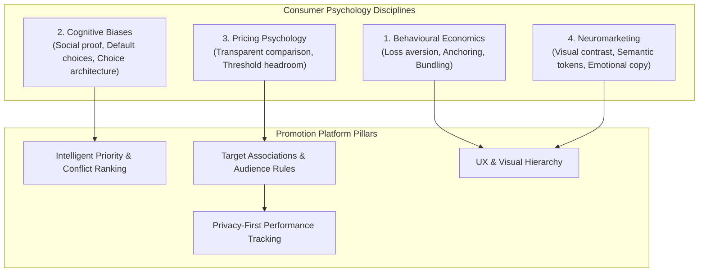
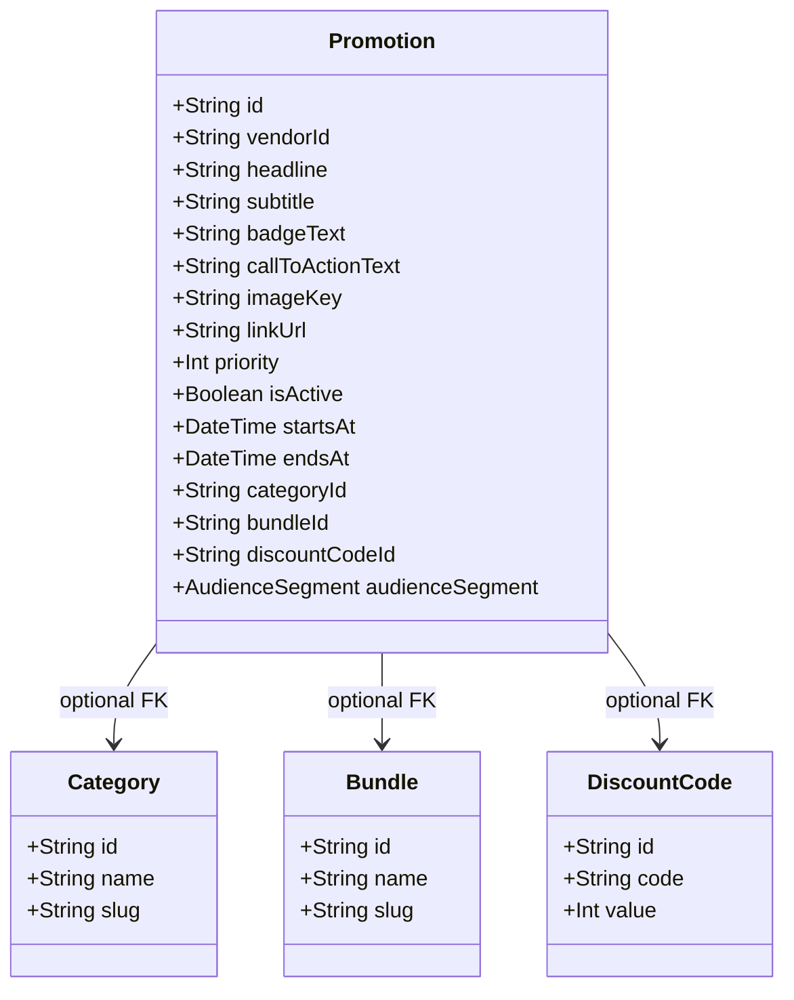
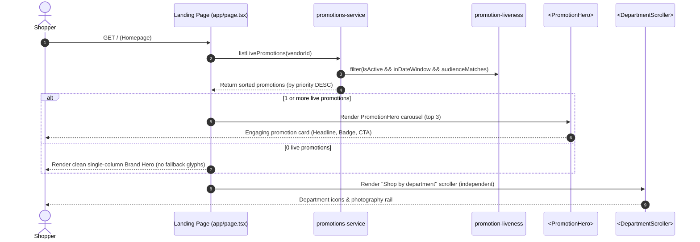

# Promotion Intelligence Platform & Storefront Experience (plan)

## 1. Product Vision & Commercial Objectives

Promotions in e-commerce are frequently treated as simple decorative banners that link to arbitrary category pages. For independent UK retailers competing with supermarkets and quick-commerce giants, blunt discounts erode gross margin while generic carousel banners suffer from banner blindness, cognitive overload, and low conversion.

The **Merqify Promotion Intelligence Platform** transforms promotions from passive image carousels into a customer-focused, psychology-led conversion engine. Grounded in behavioural economics, cognitive decision architecture, and pricing psychology, the platform enables independent merchants to:
1. **Drive High-Margin Action:** Guide shoppers toward curated bundles, higher-subtotal tiers, and genuine store-wide incentives without eroding catalog price integrity.
2. **Eliminate Friction & Decision Fatigue:** Deliver a curated set of 1–3 highly relevant promotions ranked by intelligent priority, rather than rotating endless disjointed slides.
3. **Respect Ethical Marketing & UK Legal Standards:** Adhere to UK Competition and Markets Authority (CMA) and Advertising Standards Authority (ASA) guidelines regarding transparent strikethrough pricing, genuine availability, and clear promotional terms.
4. **Preserve Operational Simplicity:** Maintain a single multi-tenant codebase on Cloudflare Workers and Neon Postgres with zero speculative external infrastructure, reusing existing catalogue, bundle, and discount-code systems.

---

## 2. Consumer Psychology Strategy

The promotional system integrates four core behavioural science and UX disciplines:

### 2.1 Behavioural Economics
- **Loss Aversion & Scarcity:** Real temporal boundaries ("Offer ends Sunday", "Limited time") trigger loss aversion far more effectively than arbitrary countdown timers. All promotion end dates reflect actual database `endsAt` values.
- **Anchoring & Perceived Value:** When a promotion targets a `Bundle`, the UI anchors the value against the individual item prices (`Product.basePrice`), displaying genuine bundle convenience without fabricating inflated historical prices.
- **Goal Gradient & Threshold Anchoring:** For discount-code promotions requiring minimum spend (`minSubtotalPence`), the hero and promotional chips highlight proximity to reward (e.g. *"Spend £30.00 to save £5.00 with code SAVE5"*).

### 2.2 Cognitive Biases & Decision Architecture
- **Choice Architecture & Reduced Fatigue:** Presenting shoppers with 12 rotating banners creates paralysis. The engine caps visible active hero promotions (default top 3 ordered by `priority DESC`), ensuring clear, decisive calls-to-action.
- **Default Choices (The Nudge):** High-priority promotions direct shoppers to curated solutions (e.g. "Family Weekly Essentials Bundle") rather than open-ended category archives, reducing clicks-to-cart.
- **Social Proof & Familiarity:** Support for promotional badges (`badgeText`, e.g., *"Customer Favourite"*, *"Weekend Special"*, *"Chef's Pick"*) leverages informational social influence.

### 2.3 Pricing Psychology
- **Contextual Discount Framing:** 
  - *Percentage discounts* (`PERCENTAGE`) are ideal for store-wide or department exploration where basket sizes vary.
  - *Fixed cash discounts* (`FIXED_AMOUNT`) provide concrete, immediate mental value on high-ticket bundles or specific minimum baskets.
- **Transparent Strikethroughs:** Strikethroughs are strictly derived from real `Product.originalPrice` and active `DiscountCode.value`. Fake regular prices or manipulated baselines are prevented at the data model level.
- **Delivery Incentive Alignment:** Delivery thresholds (`VendorConfig.freeDeliveryThresholdPence`) harmonize with promotional messaging so shoppers don't abandon baskets due to unexpected shipping friction.

### 2.4 Neuromarketing & Visual UX
- **Visual Saliency & Contrast Hierarchy:** Promotion cards utilize semantic brand tokens (`bg-primary`, `bg-action`, `bg-accent`) that automatically adapt to vendor branding while guaranteeing WCAG 2.2 AA contrast against white and text scrims.
- **Mobile-First Touch Ergonomics:** High-conversion thumb zones with generous 44px+ tap targets, accessible swipe gestures, and immediate tactile feedback.
- **Zero Fallback Clutter:** When no promotions are active, the system completely removes the promotional well, expanding the brand value proposition into a confident single-column layout rather than displaying empty slots or irrelevant fallback icons.

---

## 3. System Architecture & Entity Separation

To avoid overengineering while preparing for future scaling, we evaluate the separation of **Promotion**, **Offer**, **Audience**, and **Creative**:

### Architectural Decisions
1. **V1 Unified Model (Practical & High Performance):** Rather than creating 4 normalized tables requiring expensive multi-table joins on every edge request, the `Promotion` table encapsulates:
   - **Creative:** `headline`, `subtitle`, `badgeText`, `callToActionText`, `imageKey`, `altText`.
   - **Offer Hook:** Optional foreign keys to existing first-class domain models (`categoryId`, `bundleId`, `discountCodeId`).
   - **Scheduling & Priority:** `startsAt`, `endsAt`, `isActive`, `priority` (integer ranking for conflict resolution).
   - **Audience Hook:** `audienceSegment` enum (`ALL`, `NEW_CUSTOMER`, `RETURNING_CUSTOMER`, `LOYALTY_MEMBER`).
2. **Reusing Core Seams:**
   - Bundles are calculated dynamically by `lib/bundle-pricing.ts`.
   - Discount codes are validated by `lib/discounts.ts` and redeemed via `DiscountRedemption`.
   - Storage uses S3-compatible R2 upload via `lib/storage.ts`.
   - Multi-tenancy strictly injects `vendorId` across all queries (`lib/repositories/promotions.ts`).

---

## 4. Customer Journey & Storefront Flow

---

## 5. Phased Implementation Roadmap

### Phase V1: Core Promotions, Pricing Integrity & Psychology-Led UX (Current Scope)
- Hand-authored migration replacing `DepartmentCampaign` with `Promotion`.
- Pure repository layer (`lib/repositories/promotions.ts`) with strict vendor scoping.
- Support for Store-wide, Department, Bundle, and Discount Code targets.
- Intelligent priority ranking (`priority` integer) and scheduling windows (`startsAt`/`endsAt`).
- Staff management at `/staff/promotions` (list + `/new` + `/[id]`) with contextual target pickers and real-time previews.
- Storefront `<PromotionHero>` carousel displaying only genuine live promotions with psychological badge callouts (`badgeText`) and custom CTA copy (`callToActionText`).
- Clean hero empty state (omits promo column, displays single-column brand value hero).
- Independent `"Shop by department"` scroller preserved.

### Phase V2: Customer Segmentation & Privacy-First Analytics (Next Milestone)
- Audience filtering: Evaluate user session state (guest vs signed-in, first-order vs returning, loyalty tier) to surface personalized promotions.
- Privacy-first event telemetry: Aggregate daily counters (`PromotionImpression`, `PromotionClick`, `PromotionConversion`) in PostgreSQL without third-party tracking scripts or PII.
- Staff analytics dashboard: Click-through rate (CTR) and attributed conversion revenue per promotion.

### Phase V3: A/B Testing & Dynamic Conversion Optimisation (Future Scaling)
- Promotional variant testing: `PromotionVariant` (Headline A vs B, Imagery A vs B) with deterministic hashing based on anonymous visitor cookie.
- Automatic winner identification: Highlighting statistically significant conversion lifts in the staff back-office.
